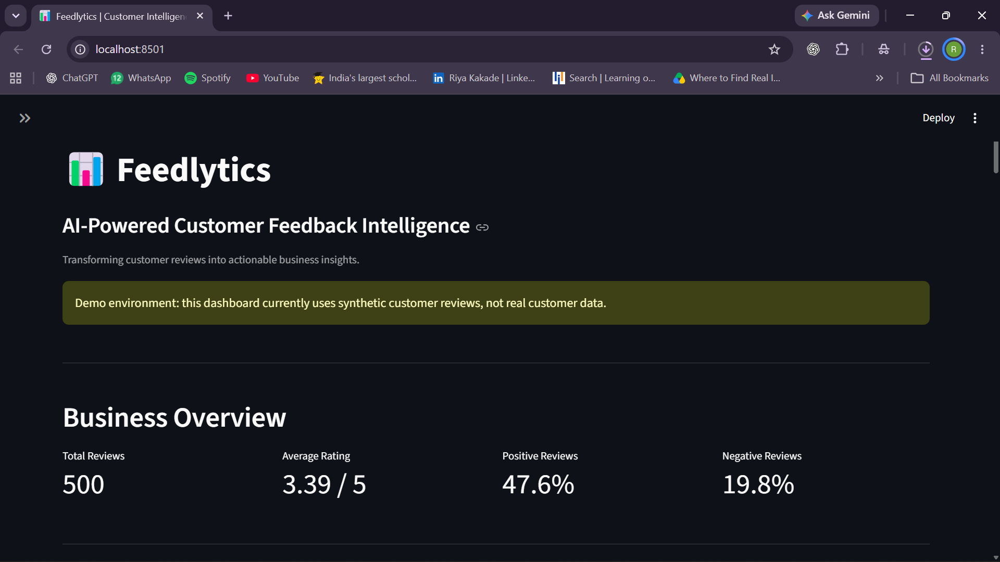
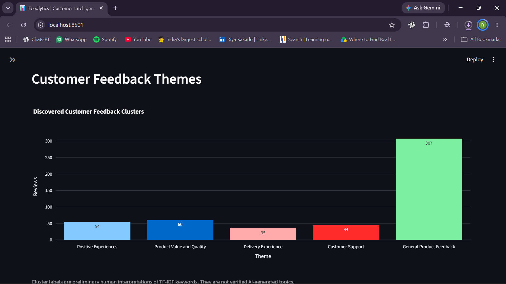
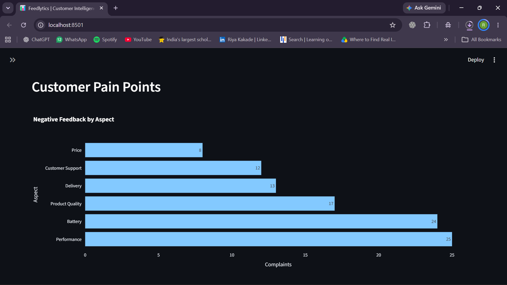
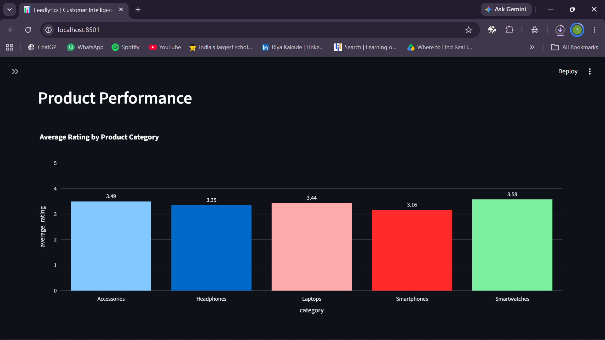
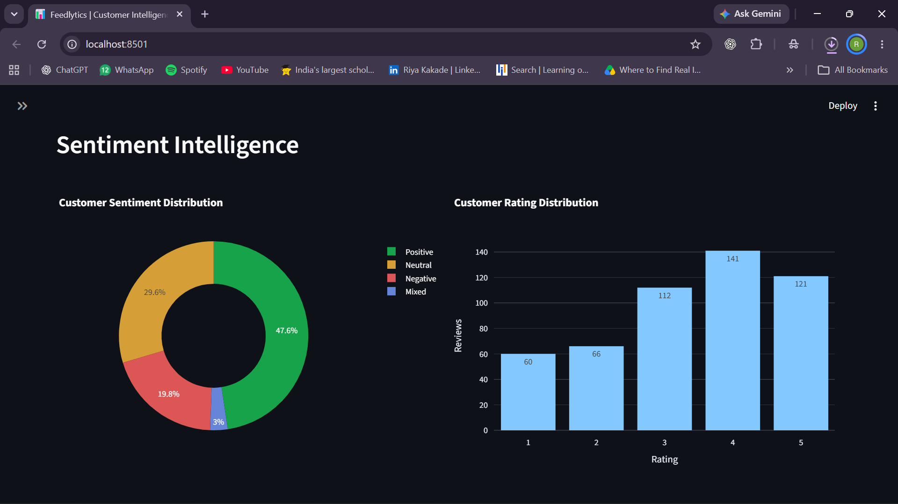
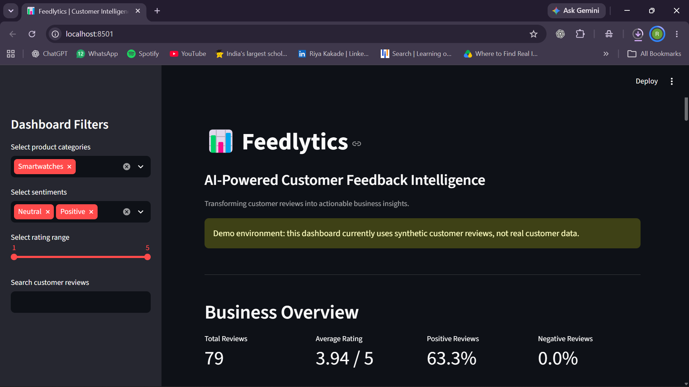
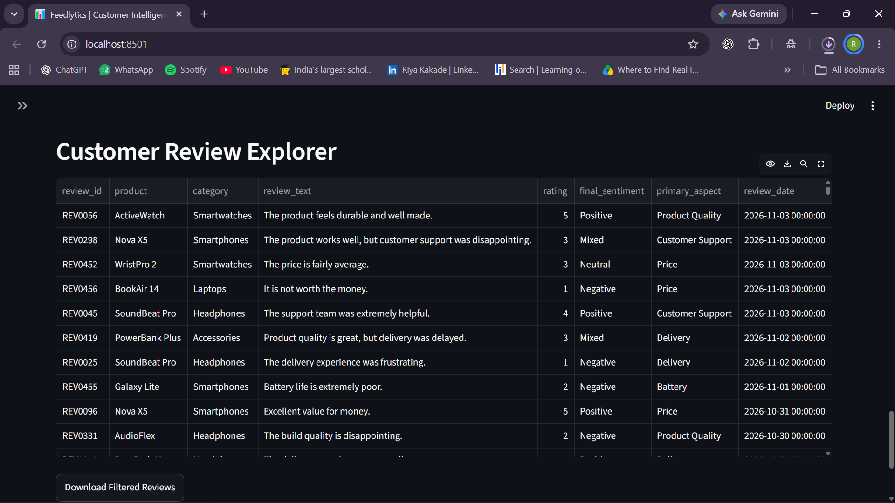

# Feedlytics – AI-Powered Customer Feedback Intelligence

Feedlytics is a Python-based data analytics project that analyzes customer reviews to uncover sentiment patterns, product issues, and customer feedback trends.

It combines exploratory data analysis, NLP-based sentiment classification, aspect-level feedback analysis, and machine learning-based topic discovery in an interactive Streamlit dashboard.

## Project Objectives

- Analyze customer feedback and ratings.
- Classify reviews into Positive, Negative, Neutral, and Mixed sentiment.
- Identify product aspects associated with negative feedback.
- Discover recurring themes using TF-IDF and K-Means clustering.
- Present insights through an interactive dashboard.

## Tech Stack

- **Language:** Python
- **Data Analysis:** Pandas, NumPy
- **Visualization:** Plotly
- **NLP:** VADER Sentiment
- **Machine Learning:** Scikit-learn, TF-IDF, K-Means
- **Dashboard:** Streamlit

## Project Structure

```text
Feedlytics/
├── app/
│   └── main.py
├── data/
│   ├── raw/
│   └── processed/
├── notebooks/
├── reports/
├── screenshots/
├── src/
│   ├── analysis/
│   │   ├── eda.py
│   │   └── topic_discovery.py
│   ├── nlp/
│   │   └── sentiment_analysis.py
│   └── generate_dataset.py
├── .gitignore
├── README.md
└── requirements.txt
```

## Key Features

1. **Exploratory Data Analysis:** Examines ratings, product categories, review trends, and feedback aspects.
2. **Sentiment Analysis:** Uses VADER to classify customer reviews.
3. **Aspect-Level Analysis:** Identifies sentiment associated with aspects such as battery, delivery, performance, and product quality.
4. **Topic Discovery:** Uses TF-IDF and K-Means to group similar reviews.
5. **Interactive Dashboard:** Provides filters, charts, KPIs, and a review explorer.

## 📸 Dashboard Preview

### 1. Dashboard Overview
Get a quick view of customer feedback, key metrics and overall sentiment.



### 2. Customer Feedback Analysis
Explore customer feedback themes and identify recurring issues.



### 3. Category Analysis
Compare feedback and performance across product categories.



### 4. Product Performance
Explore product-level insights and customer ratings.



### 5. Sentiment Analysis
Understand the distribution of positive, negative, neutral and mixed reviews.



### 6. Dashboard Filters
Interactively filter customer feedback to explore specific results.



### 7. Customer Review Explorer
Explore individual reviews and their associated analysis.



## Dataset

The project currently uses a synthetic dataset containing 500 customer reviews across five product categories.

The dataset is generated for demonstration and experimentation. It does not represent actual customer transactions or opinions.

## Model Evaluation

The initial VADER-based sentiment classification achieved **68.20% accuracy** against the synthetic dataset's expected sentiment labels.

This is a baseline result, not evidence of real-world performance. The dataset's synthetic nature and the limited separation of some topic clusters are important limitations.

## Installation and Setup

Clone the repository:

```bash
git clone YOUR_GITHUB_REPOSITORY_URL
cd Feedlytics
```

Install dependencies:

```bash
python -m pip install -r requirements.txt
```

Generate the dataset:

```bash
python src/generate_dataset.py
```

Run the analysis scripts:

```bash
python src/analysis/eda.py
python src/nlp/sentiment_analysis.py
python src/analysis/topic_discovery.py
```

Launch the dashboard:

```bash
python -m streamlit run app/main.py
```

## Future Improvements

- Test with real-world, appropriately licensed customer review data.
- Improve mixed-sentiment detection.
- Evaluate topic clustering using suitable clustering metrics.
- Experiment with more advanced NLP models.
- Add further product-level insights and interactive visualizations.

## Author

Developed as a Python and Data Analytics portfolio project.
